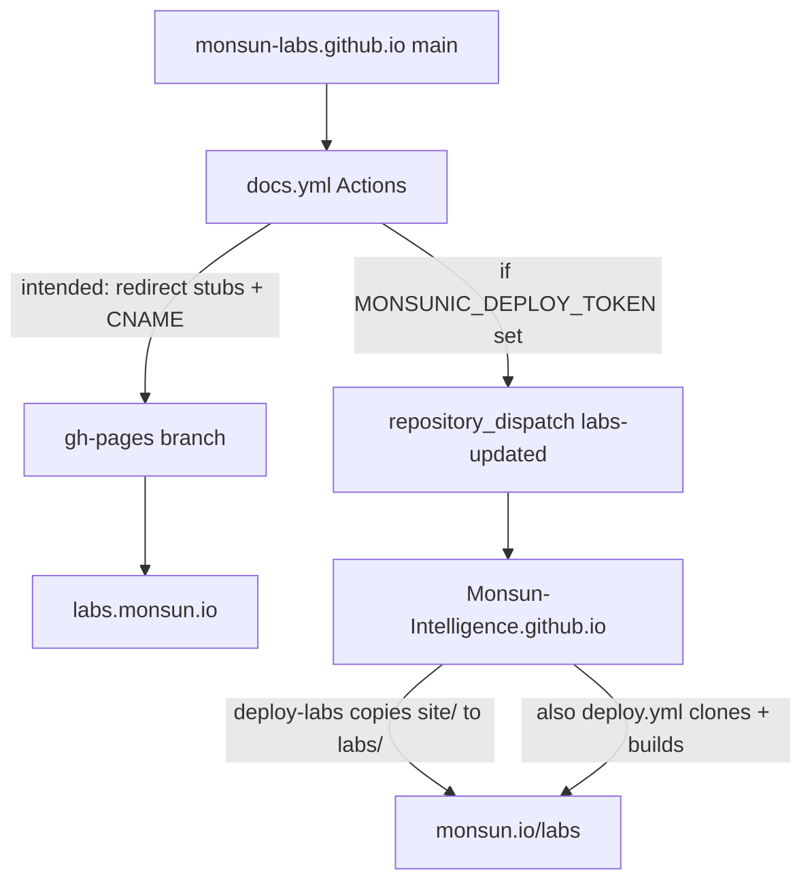

# 04 — Website & Content Audit

**Phase:** 0 — Discovery & Inventory  
**Date:** 2026-11-27  
**Mode:** Read-only  
**Canonical intent:** `https://monsun.io/labs/` (Approach A — keep Zensical)

---

## 1. Architecture

| Item | Observation |
|------|-------------|
| Generator | Zensical (`zensical.toml`) |
| Source | `docs/**/*.md` (6 pages) |
| Theme | Material-style; light/dark palette; tabs, instant nav, search |
| Extra CSS | `docs/stylesheets/home.css` |
| Favicon config | `#favicon` commented out — default theme favicon in build |
| Logo config | Default (no custom logo path) |
| Build output | `site/` committed |
| Nav | Home, Tutorials (+ Point Extraction), Open Data Stack, Community |
| Extensions | Admonitions (`!!! note`), icons in front matter |

### Deployment topology (observed)

**Observed HTTP (not DNS config claims):**

| URL | Status | Canonical link | Notes |
|-----|--------|----------------|-------|
| `https://monsun.io/labs/` | 200 | `https://monsun.io/labs/` | Serves Monsun Labs; `Server: GitHub.com` |
| `https://monsun.io/labs/tutorials/extract-point/` | 200 | matching path | Content present |
| `https://labs.monsun.io/` | 200 | **`https://monsun-labs.github.io/`** | Full site, **not** redirect stub |
| `https://labs.monsun.io/tutorials/extract-point/` | 200 | `https://monsun-labs.github.io/tutorials/...` | Duplicate host |

`origin/gh-pages` tip still contains **full built site** + `CNAME=labs.monsun.io`, not the slim `redirect/` HTML. Actions run for commit `add redirection` **failed** (0s, empty jobs, log unavailable).

---

## 2. Content inventory

| Page | Source | Live on monsun.io/labs | Notes |
|------|--------|------------------------|-------|
| Home | `docs/index.md` | Yes | Custom hero; class prefix `nw-home__` |
| Tutorials index | `docs/tutorials/index.md` | Yes | 1 shipped + roadmap |
| Point Extraction | `docs/tutorials/extract-point/index.md` | Yes | Long landing; Colab + GitHub |
| Open Data | `docs/open-data/index.md` | Yes | |
| Community | `docs/community/index.md` | Yes | |
| LICENSE-CONTENT | `docs/LICENSE-CONTENT.md` | In nav via footer | CC-BY |
| DATA_SOURCES | repo root MD | Linked from open-data | Not necessarily a site nav page |

Roadmap (Coming Next): Ocean Map Plot (Jul 2026), Time Series (Aug 2026), Waves Basics (Sep 2026) — **dates relative to audit day Nov 2026 are overdue** if still unpublished.

---

## 3. Extract Point consistency (site vs GitHub)

| Claim on site | GitHub `origin/main` | HEAD WIP |
|---------------|----------------------|----------|
| Colab badge → `monsun-labs/.../main/notebooks/...` | Notebook exists; **Nusawave branding inside** | N/A |
| Step 0 / `requirements-notebook.txt` / Release wget | Present | Missing |
| `extract_utils` functions | Present | Empty file |
| Hs, Tp, wind + benchmarks time&RAM | Present | Mostly absent |
| Sample 20×20, 0.5°, ~120 MB, 2024 | Largely aligned | Divergent |
| Never hardcode indices | Taught correctly on site/`main` | HEAD uses 42/864 |

**Finding WEB-01 (HIGH):** Site accurately describes a tutorial that exists on `origin/main`, but that branch is Nusawave-branded; Monsun-named branch is not feature-equivalent.

**Finding WEB-02 (HIGH):** Dual hosting — `labs.monsun.io` serves full duplicate with wrong canonical, competing with `monsun.io/labs/`.

---

## 4. SEO & metadata

| Item | Evidence | Assessment |
|------|----------|------------|
| Page titles | `Home - Monsun Labs`, etc. | OK |
| Meta description | `Learn metocean analystics from open data. Free forever.` | **Typo:** `analystics` → analytics (zensical.toml + live) |
| Canonical on monsun.io/labs | Correct `monsun.io/labs/...` | OK |
| Canonical on labs.monsun.io | Points to `monsun-labs.github.io` | **Wrong for redirect strategy** |
| Sitemap (built `site/sitemap.xml`) | URLs under `https://monsun.io/labs/` | OK for canonical host |
| robots.txt | Not observed as custom in source | Default/unknown |
| Open Graph image | **none** in live HTML | Missing social preview |
| Favicon | Default `./assets/images/favicon.png` (theme) | No custom Monsun favicon configured |
| Repo homepage | `monsun-labs.github.io` | Non-canonical |

---

## 5. Domain & routing findings

| ID | Severity | Finding | Evidence | Impact | Remediation | Phase | Verification |
|----|----------|---------|----------|--------|-------------|-------|--------------|
| WEB-D1 | **HIGH** | Redirect workflow failed; gh-pages still full site | Actions run `32562149955` failure; `git show origin/gh-pages:index.html` is full Zensical page | `labs.monsun.io` does not redirect | Fix Actions; deploy `redirect/` only; verify CNAME | 1 | HTTP + gh-pages tree |
| WEB-D2 | **HIGH** | Wrong canonical on labs host | Live HTML canonical → `monsun-labs.github.io` | SEO duplicate / split signals | After redirect, canonical only on monsun.io/labs | 1 | View-source |
| WEB-D3 | MEDIUM | README promotes `monsun-labs.github.io` | README line 5 | Contributor/user confusion | Point to canonical | 1 | README |
| WEB-D4 | MEDIUM | Description typo | `analystics` in toml + live | SEO/professionalism | Fix string + rebuild/deploy | 1 | Live meta |
| WEB-D5 | MEDIUM | No OG image / weak social preview | No `og:image` | Weak LinkedIn shares | Add branded OG asset | 1–2 | View-source |
| WEB-D6 | LOW | Favicon is generic theme default | favicon commented in toml | Weak brand mark | Add Monsun favicon | 2 | Config |
| WEB-D7 | INFO | `monsun.io/labs` served via GitHub edge | Response headers | Consistent with Intelligence Pages host | Document topology | — | Headers |
| WEB-D8 | MEDIUM | Host deploy branch ambiguity | `deploy-labs.yml` uses `main`; default branch `dev` | Risk of updating non-live branch | Align with actual Pages branch | 1 | Host repo settings |
| WEB-D9 | LOW | Roadmap dates past due | Tutorials index Jul–Sep 2026 | Stale roadmap | Update or mark deferred | 1 | Content review |
| WEB-D10 | INFO | Relative CTAs on home | `href="tutorials/"` etc. | Fine under `/labs/` base | Keep | — | Browse |

**DNS/hosting inference boundary:** CNAME file on `gh-pages` contains `labs.monsun.io`. Live responses prove GitHub Pages serves that host. Exact DNS registrar records were **not** inspected — mark PARTIAL for DNS.

PowerShell probe of `https://monsun-labs.github.io/` failed locally (client error); `labs.monsun.io` content and canonical imply that host still publishes the Labs site build.

---

## 6. Zensical keep / replace recommendation

**Keep Zensical.** No technical blocker found that forces replacement. Issues are content sync, redirect CI failure, SEO metadata, and brand CSS naming — not generator limitations.

---

## 7. Broken / risk links

| Link | Risk |
|------|------|
| Colab → `monsun-labs/extract-point` `main` | Opens Nusawave-branded notebook (functional shape likely OK) |
| Site GitHub tutorial links | Correct org path |
| LinkedIn `monsunic` | Used consistently on site |
| `DATA_SOURCES.md` GitHub blob link | OK if file remains on main |
