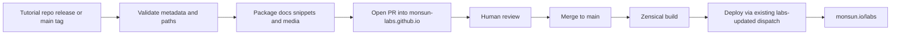

# 07 — Future Publishing Architecture

**Phase:** 0 — Discovery only (no implementation)  
**Date:** 2026-11-27  
**Constraints:** Approach A — Evolution; keep Zensical; keep `https://monsun.io/labs/`; GitHub primary; Extract Point as pilot; human review before publish; **no automatic notebook execution**.

---

## 1. Desired flow

---

## 2. Content & media contract (recommended)

Introduce a small, versioned **tutorial manifest** in each tutorial repo, e.g. `labs-publish/manifest.yaml`:

| Field | Purpose |
|-------|---------|
| `slug` | URL slug (`extract-point`) |
| `title`, `summary` | Landing card + SEO |
| `version` / `git_sha` / `released_at` | Provenance |
| `colab_url`, `repo_url` | Verified links |
| `sample_data.release_tag` | e.g. `v0.1-data` |
| `nav_label` | Zensical nav text |
| `status` | `early` / `stable` |
| `media[]` | path, dest, alt, caption, attribution, license |
| `doc_blocks[]` | optional Markdown fragments to sync |

Website repo receives **copies** under agreed paths, e.g.:

- `docs/tutorials/<slug>/index.md` (generated or patched sections)
- `docs/tutorials/<slug>/media/*`
- `docs/tutorials/index.md` row update

Do **not** sync notebooks or NetCDF into the website repo.

---

## 3. Approach comparison

### Approach A — GitHub Actions + `repository_dispatch` / PR generation

**Pattern:** On tutorial `release` published (or workflow_dispatch), tutorial workflow validates manifest → opens PR against `monsun-labs.github.io` (via app or fine-scoped PAT) → optional `repository_dispatch` after merge handled by **existing** Labs → host chain.

| Pros | Cons |
|------|------|
| Fits current mental model (dispatch already used) | Dispatch alone auto-merges risk if not gated |
| Explicit human PR review | Needs token/app with PR permission on website repo |
| Simple for one pilot tutorial | Ad hoc scripts per repo if not templated |

**Security:** Use GitHub App installed only on Labs repos; least privilege (`contents: write` limited to PR branches); **never** grant secrets to `pull_request` from forks; validate only paths listed in manifest; reject absolute URLs to unexpected hosts.

### Approach B — Reusable workflow + media manifest (recommended)

**Pattern:** Central reusable workflow in `monsun-labs.github.io` or a tiny `monsun-labs/labs-actions` repo:

`workflow_call` inputs: `tutorial_repo`, `ref`, `manifest_path`.

Steps: checkout tutorial → schema-validate manifest → copy allowlisted media → render landing Markdown from template → commit to branch `publish/<slug>-<sha>` → `gh pr create` → wait for human merge.

After merge, **existing** `docs.yml` builds Zensical and dispatches `labs-updated` (once CI-01 fixed).

| Pros | Cons |
|------|------|
| One implementation for all future tutorials | Small upfront design cost |
| Idempotent: same SHA → same PR diff | Requires manifest discipline |
| Clear allowlist / duplicate prevention | Template must not overwrite hand-crafted prose blindly |
| Aligns with Evolution (keep Zensical + host deploy) | |

**Hybrid reality:** B for sync/PR; keep today’s dispatch only for **post-merge site deploy** (already present).

---

## 4. Recommendation

**Adopt Approach B (reusable workflow + manifest-driven PR), with Approach A’s existing `labs-updated` dispatch retained solely for host deploy.**

Rationale from Phase 0 evidence:

- Website and tutorials are already **two-repo**; manual checklist in README proves human sync is the current process.
- Extract Point drift shows unchecked dual branches break site truth — automation must publish from a **single declared ref** (prefer Release or `main` tip).
- Host deploy path already rebuilds Zensical; no need for a third static host.
- Media gap is severe; manifest is the lightest reliable sync unit.
- Empty tutorial CI means greenfield for reusable workflow without migrating legacy Actions.

---

## 5. Security & reliability checklist

| Control | Requirement |
|---------|-------------|
| Auth | GitHub App or fine-scoped PAT; no org-wide classic PAT in tutorial forks |
| PR from forks | Build-only; no publish token |
| Notebook execution | **Forbidden** in CI |
| Path allowlist | Only `labs-publish/**` and listed media |
| Idempotency | Keyed by `slug` + `git_sha`; update PR in place |
| Duplicates | One open publish PR per slug |
| Failure reporting | Actions summary + PR comment |
| Rollback | Revert merge commit on website repo; re-dispatch deploy |
| Human review | Required reviewers on `docs/tutorials/**` |
| Secrets | No CDS keys in website CI |

---

## 6. Pilot scope (Extract Point)

1. Stabilize publish branch content (see report 03) **before** automating.
2. Add `labs-publish/manifest.yaml` describing current landing facts.
3. Implement reusable workflow; run manually once to open first PR.
4. Keep monthly checklist as fallback until two successful publishes.

---

## 7. Explicit non-goals (near term)

- Monorepo merge of all tutorials
- Replacing Zensical
- Auto-deploying tutorial `main` on every push without PR
- Syncing full notebook outputs or NetCDF into Pages
- Executing CDS downloads in GitHub-hosted runners
