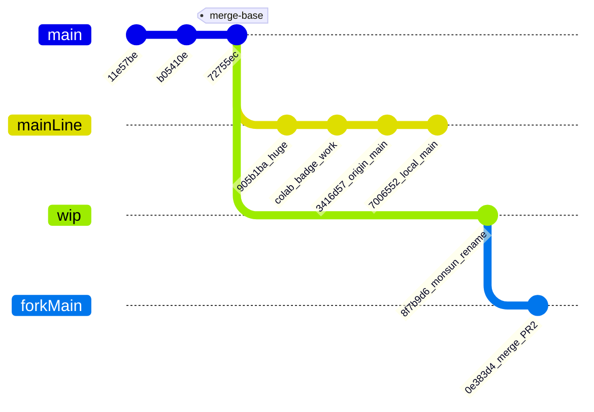

# 01 — Git Ancestry and Branch Comparison

**Phase:** 1A — Source of Truth Decision  
**Date:** 2026-11-27  
**Mode:** Read-only (no fetch, checkout, or mutation)  
**Repo:** `C:\Users\yothu\tyo\monsun.io\monsun-labs\extract-point`

---

## 1. Before-state snapshot (start of Phase 1A)

| Field | Value |
|-------|-------|
| Branch | `add-extract-utils` |
| HEAD | `8f7b9d691c338a346df986fff7d3080a583c1d6c` |
| Tracking | `fork/add-extract-utils` (up to date) |
| Porcelain | `?? data/era5_sample.nc` only |
| `origin` | `git@github.com:nusawave-labs/extract-point.git` |
| `fork` | `git@github.com:tyorus/extract-point.git` |

---

## 2. Ref tip table

| Ref | SHA | Date | Subject |
|-----|-----|------|---------|
| `HEAD` / `add-extract-utils` / `origin/add-extract-utils` / `fork/add-extract-utils` | `8f7b9d6` | 2026-08-19 | change nusawave to monsun |
| Local `main` | `7006552` | 2026-08-19 | minor updates |
| `origin/main` | `3416d57` | 2026-06-21 | Merge branch dev into main |
| `fork/main` | `0e383d4` | 2026-08-19 | Merge PR #2 from tyorus/add-extract-utils |
| `dev` / `origin/dev` | `ad63ac9` | 2026-06-21 | Revert Colab badge to standard markdown link |
| Tag `v0.1-data` | on ancestry via `39544f1` | 2026-06-13 | sample data release tag |

---

## 3. Merge bases (verified)

| Pair | Merge-base | Notes |
|------|------------|-------|
| `origin/main` ∩ `main` | `3416d57` (= `origin/main`) | `main` is **descendant** of `origin/main` |
| `origin/main` ∩ `add-extract-utils` | `72755ec` | Diverged **before** main-line `huge updates` |
| `main` ∩ `add-extract-utils` | `72755ec` | Same |
| `add-extract-utils` ∩ `fork/main` | `8f7b9d6` | WIP tip is ancestor of fork merge |
| `origin/main` ∩ `dev` | `ad63ac9` (= `dev`) | `dev` ancestor of `origin/main` |

**Ancestor checks:**

- `origin/main` **is** ancestor of `main`
- `add-extract-utils` **is** ancestor of `fork/main`
- `dev` **is** ancestor of `origin/main` and `main`
- `add-extract-utils` is **not** ancestor of `origin/main` / `main`
- `origin/main` / `main` are **not** ancestors of `add-extract-utils`

---

## 4. Topology narrative

**Plain language:**

1. Shared history up through `72755ec` (“update notebook, add script do download era5”).
2. At that point the tree was already a **thin stub**: empty `src/extract_utils.py`, empty `benchmarks/benchmark.py`, short notebook (~16 KB), no `requirements-notebook.txt`, no benchmark PNGs.
3. **Main line** then landed `905b1ba` (“huge updates”), which **added** the full educational implementation, later Colab-badge polish on `dev`, merges into `origin/main`, then local `7006552` (notebook cell `id` metadata only).
4. **WIP line** did **not** receive `huge updates`. Commit `8f7b9d6` only renames Nusawave→Monsun in `LICENSE`, `README.md`, and three notebook strings on top of the thin tree.
5. **`fork/main`** is a GitHub merge of that WIP into the fork (`0e383d4` parents: `02efff7` + `8f7b9d6`). Tree of `fork/main` is **identical** to `add-extract-utils` (`git diff` empty).

**Finding GA-01 (HIGH):** The Monsun WIP is **not** a deletion of the full tutorial. It is a **divergent rename of the pre-`huge-updates` stub**. Selecting WIP as baseline would **omit** main-line work that never existed on that branch.

**Finding GA-02 (INFO):** `fork/main` contains a merge of the stripped/Monsun WIP; it does not reintroduce full-tutorial files.

---

## 5. Unique commits

| Range | Commits |
|-------|---------|
| `origin/main..main` | `7006552` only |
| `origin/main..add-extract-utils` | `8f7b9d6` only |
| `add-extract-utils..origin/main` | 9 commits (incl. `905b1ba`, badge work, merges) |
| `add-extract-utils..main` | 10 commits (above + `7006552`) |
| `add-extract-utils..fork/main` | 2 merge commits (`02efff7`, `0e383d4`) |

Left-right counts:

| Compare | Left \| Right |
|---------|----------------|
| `origin/main...main` | 0 \| 1 |
| `origin/main...add-extract-utils` | 9 \| 1 |
| `main...add-extract-utils` | 10 \| 1 |
| `add-extract-utils...fork/main` | 0 \| 2 |

---

## 6. Two-dot tree delta (capability-relevant)

`git diff --stat origin/main..add-extract-utils` → **14 paths**, net **−1296 / +239** lines: WIP lacks full utils, benchmarks, assets, notebook depth, `requirements-notebook.txt`, enriched `.gitignore` / `data/README` / download defaults.

Critical nuance: those paths are **absent or empty on the WIP lineage**, not “deleted by the Monsun commit.” The Monsun commit itself touches only 3 files (+6/−6).

---

## 7. Potentially lost work if wrong baseline chosen

| If baseline = | Lost |
|---------------|------|
| WIP / `fork/main` | Entire `905b1ba` educational stack + later main polish |
| `origin/main` only | Local `7006552` notebook cell IDs (metadata; low risk) |
| Local `main` | Monsun string inventory from `8f7b9d6` (must be re-applied deliberately) |

**No recommendation to delete any branch** in this phase.

---

## 8. Findings

| ID | Severity | Component | Evidence | Impact | Recommended action | Verification | Phase |
|----|----------|-----------|----------|--------|--------------------|--------------|-------|
| GA-01 | HIGH | Topology | MB=`72755ec`; `905b1ba` only on main line | WIP≠post-full tutorial | Do not use WIP as capability baseline | `git merge-base`, `git log` | 1A→1B |
| GA-02 | INFO | `fork/main` | Merge parents + empty tree diff vs WIP | Fork follows thin Monsun tree | Treat as WIP mirror | `git diff wip fork/main` | 1A |
| GA-03 | LOW | Local `main` | `7006552` adds cell `id`s only | Metadata drift vs published tip | Prefer local `main` as working tip if keeping IDs | `git show 7006552` | 1B |
| GA-04 | MEDIUM | Remotes | `origin` still `nusawave-labs@` URL | Operator confusion | Retarget later (ops); not a content baseline issue | `git remote -v` | 1B+ |
