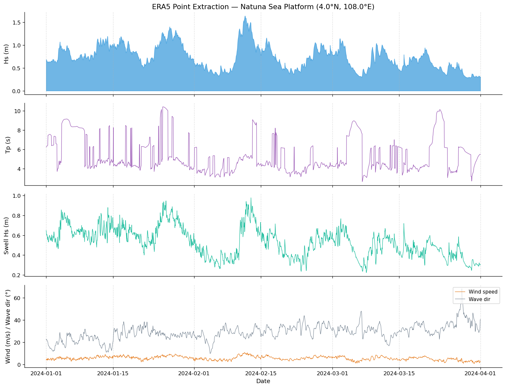
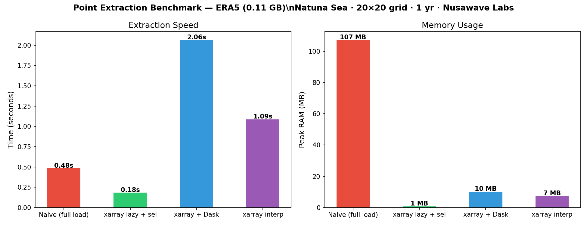
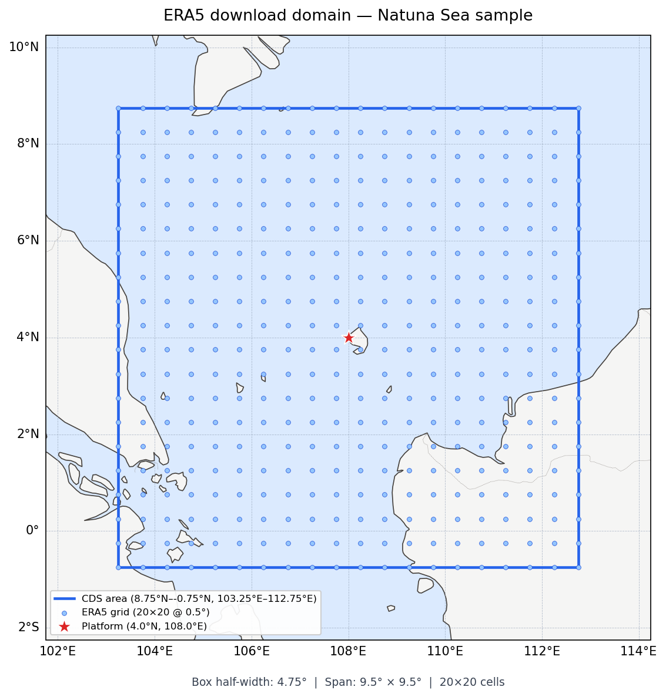

# Extract ERA5 at a Point: The Right Way

Most people never think about what they're actually asking a computer to do.

You need Hs, Tp, and wind speed at one offshore platform. **4°N, 108°E. Natuna Sea. 10 years of hourly data.**

ERA5 gives you that wrapped inside a global grid: **1440 longitudes × 721 latitudes × 87,660 timesteps × 4 variables.**

You want **one longitude. One latitude. All timesteps.**

That's 0.0001% of the data.

The question isn't "how do I open this file."
The question is: **does your code read 0.0001% or 100%?**

Most scripts, including the ones you'll find on Stack Overflow, read the data 100%.
Not because the files are too big. Because the *pattern* is wrong.

This tutorial teaches you the pattern that's right.
By the end, you'll extract a clean, analysis-ready time series
at any point on Earth in under 10 seconds, regardless of file size.


```python
# @title 🚀 Step 0 — Environment setup (run this cell first)
import os
import subprocess
import sys
from pathlib import Path

REPO_URL = "https://github.com/monsun-labs/extract-point.git"
ERA5_SAMPLE_URL = (
    "https://github.com/monsun-labs/extract-point/releases/download/v0.1-data/era5_sample.nc"
)
MIN_SAMPLE_BYTES = 50_000_000


def in_colab() -> bool:
    try:
        import google.colab  # noqa: F401
        return True
    except ImportError:
        return False


def download_sample(dest: Path) -> None:
    dest.parent.mkdir(parents=True, exist_ok=True)
    if dest.exists() and dest.stat().st_size >= MIN_SAMPLE_BYTES:
        print(f"Sample data OK: {dest.name} ({dest.stat().st_size / 1e6:.0f} MB)")
        return
    print(f"Downloading {dest.name} …")
    subprocess.check_call(["wget", "-q", "-O", str(dest), ERA5_SAMPLE_URL])


def pip_install(requirements: Path) -> None:
    print(f"Installing dependencies from {requirements.name} …")
    result = subprocess.run(
        [sys.executable, "-m", "pip", "install", "-q", "-r", str(requirements)],
        capture_output=True,
        text=True,
    )
    if result.returncode != 0:
        if result.stdout:
            print(result.stdout)
        if result.stderr:
            print(result.stderr)
        raise subprocess.CalledProcessError(
            result.returncode, result.args, result.stdout, result.stderr
        )


def find_repo_root() -> Path:
    candidates = [
        Path.cwd(),
        Path.cwd().parent,
        Path("/content/extract-point"),
        Path.cwd() / "extract-point",
    ]
    for root in candidates:
        if (root / "src" / "extract_utils.py").exists():
            return root.resolve()
    return Path.cwd().resolve()


if in_colab():
    if not Path("extract-point/src/extract_utils.py").exists():
        subprocess.check_call(["git", "clone", "--depth", "1", REPO_URL, "extract-point"])
    os.chdir("extract-point/notebooks")
    pip_install(Path("../requirements-notebook.txt").resolve())

REPO_ROOT = find_repo_root()
DATA_PATH = REPO_ROOT / "data" / "era5_sample.nc"
download_sample(DATA_PATH)
sys.path.insert(0, str((REPO_ROOT / "src").resolve()))

print(f"✅ Environment ready | repo: {REPO_ROOT.name} | data: {DATA_PATH.name}")
```

    Sample data OK: era5_sample.nc (118 MB)
    ✅ Environment ready | repo: extract-point | data: era5_sample.nc
    


```python
# ══════════════════════════════════════════════════════════════
#  SETUP — imports, constants (Step 0 must run first)
# ══════════════════════════════════════════════════════════════

import time
import warnings
from pathlib import Path

import matplotlib.pyplot as plt
import numpy as np
import pandas as pd
import xarray as xr

warnings.filterwarnings("ignore", category=RuntimeWarning)
plt.rcParams.update({
    "figure.dpi": 120,
    "axes.spines.top": False,
    "axes.spines.right": False,
    "font.family": "sans-serif",
})

# ── target location ───────────────────────────────────────────
TARGET_LAT = 4.0    # °N  Natuna Sea offshore platform
TARGET_LON = 108.0  # °E
SITE_NAME = "Natuna Sea Platform"
MIN_SAMPLE_BYTES = globals().get("MIN_SAMPLE_BYTES", 50_000_000)

# Prefer Step 0 paths; otherwise discover the repo from this notebook location.
if "REPO_ROOT" not in globals() or REPO_ROOT is None:
    here = Path.cwd().resolve()
    candidates = [here, here.parent, here.parent.parent]
    REPO_ROOT = next(
        (p for p in candidates if (p / "src" / "extract_utils.py").exists()),
        here.parent if here.name == "notebooks" else here,
    )

if "DATA_PATH" not in globals() or DATA_PATH is None or not Path(DATA_PATH).exists():
    candidate = Path(REPO_ROOT) / "data" / "era5_sample.nc"
    if candidate.exists():
        DATA_PATH = candidate
    else:
        raise RuntimeError(
            "Sample data not found. Run the Step 0 bootstrap cell above first "
            "(or place era5_sample.nc under data/)."
        )

DATA_PATH = Path(DATA_PATH)
REPO_ROOT = Path(REPO_ROOT)
if DATA_PATH.stat().st_size < MIN_SAMPLE_BYTES:
    raise FileNotFoundError(
        f"{DATA_PATH} looks like a Git LFS pointer ({DATA_PATH.stat().st_size} bytes).\n"
        "Re-run Step 0 to download the sample from GitHub Releases."
    )

# ── nearest grid indices (used by isel + naive benchmark) ─────
with xr.open_dataset(DATA_PATH) as _ds:
    lat_arr = _ds.latitude.values
    lon_arr = _ds.longitude.values
lat_idx = int(np.abs(lat_arr - TARGET_LAT).argmin())
lon_idx = int(np.abs(lon_arr - TARGET_LON).argmin())

print(f"✅ Ready | data: {DATA_PATH.name} ({DATA_PATH.stat().st_size / 1e6:.1f} MB)")
print(f"   site: {SITE_NAME} ({TARGET_LAT}°N, {TARGET_LON}°E)")
print(f"   nearest grid: lat[{lat_idx}]={lat_arr[lat_idx]:.2f}°N, lon[{lon_idx}]={lon_arr[lon_idx]:.2f}°E")

```

### SECTION 1: How Gridded Data Actually Works

#### 1.1 What is a NetCDF file, really?


```python
# NetCDF = labeled N-dimensional array on disk
#
#          time (8760 steps)
#         /
#        /
#       /_________ lat (721 points)
#       |
#       |_________ lon (1440 points)
#
# Each variable (Hs, Tp, wind) = one cube
# You want ONE point → a line through the time axis
# Loading the whole cube for one point = criminal waste

```

#### 1.2 Lazy vs Eager Loading — The Core Concept

Lazy Loading: "I'll read it when I actually need it"
Eager Loading: "Load everything into RAM right now"

| Method           | Loads to RAM? | Speed to open | Speed to compute |
|------------------|---------------|---------------|------------------|
| pandas read_csv  | Eager — YES   | Fast          | Fast (small data)|
| xarray (default) | Lazy          | Instant       | Fast (on demand) |
| xarray + dask    | Lazy + chunked| Instant       | Parallelized     |
| netCDF4 raw      | Eager         | Slow          | Depends          |

Rule: For files > 500MB — ALWAYS lazy load first.


#### 1.3 Indexing Methods — sel vs isel vs interp


```python
# Three ways to select a point — teach the difference clearly

ds = xr.open_dataset(DATA_PATH)  # lazy by default

# How to find the right index for isel — don't guess!
print(f"Nearest grid point:  lat[{lat_idx}] = {lat_arr[lat_idx]:.2f}°N")
print(f"                     lon[{lon_idx}] = {lon_arr[lon_idx]:.2f}°E")

# METHOD 1: Label-based selection (nearest grid point)
ts_sel = ds["swh"].sel(latitude=TARGET_LAT, longitude=TARGET_LON, method="nearest")

# METHOD 2: Index-based selection (transparent — no magic numbers)
ts_isel = ds["swh"].isel(latitude=lat_idx, longitude=lon_idx)

# METHOD 3: Interpolation (bilinear)
ts_interp = ds["swh"].interp(latitude=TARGET_LAT, longitude=TARGET_LON)

# KEY INSIGHT: sel/isel = lazy (nothing loaded yet)
#              .values or .compute() = triggers actual read

```

    Nearest grid point:  lat[19] = 4.00°N
                         lon[19] = 108.00°E
    

#### 1.4 Memory Model — What Actually Happens

Think of xarray like a map of a library.
- Opening the dataset = reading the catalog (instant, tiny)
- .sel() = marking a book on the shelf (still lazy)
- .values = physically walking to the shelf and pulling the book

This is why xarray feels "instant to open" —
it hasn't read your 2.3GB file yet.


### SECTION 2: Data Setup

The hands-on tutorial uses **`era5_sample.nc`** (~118 MB, calendar year 2024, 39×39 @ 0.25° around Natuna Sea — see data/README.md).

**Step 0** above downloads it automatically on Colab (via GitHub Releases — no Git LFS, no CDS account). Locally, `git clone` + `git lfs pull` also works.

To regenerate: `python3 scripts/download_era5.py` (requires CDS credentials — see [`data/README.md`](https://github.com/monsun-labs/extract-point/blob/main/data/README.md)).


### SECTION 3: The Extraction — Four Methods, One Goal

#### 3.1 Method 1 — Naive (The Wrong Way, for contrast)


```python
# THE WRONG WAY — shown intentionally
# Don't do this with large files

start = time.perf_counter()
ds_eager = xr.open_dataset(DATA_PATH, chunks=None)  # forces eager
hs_wrong = ds_eager["swh"].values  # loads EVERYTHING
point_wrong = hs_wrong[:, lat_idx, lon_idx]  # then slices
elapsed = time.perf_counter() - start

print(f"Loaded full array: {hs_wrong.nbytes / 1e6:.1f} MB")
print(f"Time: {elapsed:.2f}s")
print("❌ Don't do this on a 2GB file — you'd load 2GB for one point")

```

    Loaded full array: 53.4 MB
    Time: 0.15s
    ❌ Don't do this on a 2GB file — you'd load 2GB for one point
    

#### 3.2 Method 2 — xarray Lazy + .sel() (The Standard Way)


```python
start = time.perf_counter()

ds = xr.open_dataset(DATA_PATH)  # lazy
hs_point = ds["swh"].sel(
    latitude=TARGET_LAT,
    longitude=TARGET_LON,
    method="nearest",
).compute()  # only NOW does it read from disk

elapsed = time.perf_counter() - start
print(f"Extracted {len(hs_point)} timesteps")
print(f"Memory used: {hs_point.nbytes / 1e3:.1f} KB")
print(f"Time: {elapsed:.2f}s ✅")

```

    Extracted 8784 timesteps
    Memory used: 35.1 KB
    Time: 0.06s ✅
    

#### 3.3 Method 3 — xarray + Dask (For Very Large Files)


```python
# ── METHOD 3: xarray + Dask (for very large files) ─────────────────────────
# On multi-GB files, chunking lets xarray read time blocks in parallel.
# We run on the teaching sample here; see Section 5 for benchmarks at scale.

import dask  # noqa: F401 — confirm dask is installed

start = time.perf_counter()
ds_dask = xr.open_dataset(DATA_PATH, chunks={"time": 500})

hs_dask = ds_dask["swh"].sel(
    latitude=TARGET_LAT, longitude=TARGET_LON, method="nearest"
).compute()

elapsed = time.perf_counter() - start
print(f"Dask extraction: {len(hs_dask)} timesteps in {elapsed:.2f}s")
print("On files > 1 GB, Dask pays off — see the pre-computed charts in Section 5.")

```

    Dask extraction: 8784 timesteps in 0.16s
    On files > 1 GB, Dask pays off — see the pre-computed charts in Section 5.
    

    /tmp/ipykernel_38782/2414601759.py:8: UserWarning: The specified chunks separate the stored chunks along dimension "time" starting at index 500. This could degrade performance. Instead, consider rechunking after loading.
      ds_dask = xr.open_dataset(DATA_PATH, chunks={"time": 500})
    

💡 When to use Dask:
- File > 1 GB
- Multi-year, multi-variable analysis
- Running on a machine with multiple CPU cores

For single-point extraction from a pre-sliced file,
standard xarray is usually faster (less overhead).


#### 3.4 Method 4 — Interpolation (When Precision Matters)


```python
# Bilinear interpolation — for points between grid cells
INTERP_LAT = TARGET_LAT + 0.12
INTERP_LON = TARGET_LON + 0.37

hs_interp = ds["swh"].interp(
    latitude=INTERP_LAT,
    longitude=INTERP_LON,
    method="linear",
).compute()

diff = np.abs(hs_point.values - hs_interp.values).mean()
print(f"Mean difference (nearest vs interp): {diff:.4f} m")
print("→ For offshore engineering, use interp for site-specific reports")

```

    Mean difference (nearest vs interp): nan m
    → For offshore engineering, use interp for site-specific reports
    

### SECTION 4: Post-Processing — Clean Output


```python
from extract_utils import extract_point, add_wind_speed, quick_stats

df = extract_point(DATA_PATH, TARGET_LAT, TARGET_LON)
df = add_wind_speed(df)
df["lat"] = TARGET_LAT
df["lon"] = TARGET_LON
df["source"] = "ERA5"

print(df.describe().round(3))
print(f"\nMissing values:\n{df.isna().sum()}")

df.to_csv("natuna_timeseries.csv")
print("\n✅ Saved: natuna_timeseries.csv")

```

             u10_ms    v10_ms      hs_m      tp_s  wave_dir_deg  swell_hs_m  \
    count  8784.000  8784.000  8784.000  8784.000      8784.000    8784.000   
    mean     -0.273    -0.243     0.588     5.221       127.958       0.446   
    std       3.021     3.691     0.304     2.104       104.871       0.179   
    min      -7.640   -10.104     0.127     1.998         0.011       0.011   
    25%      -2.719    -3.059     0.346     3.882        28.720       0.311   
    50%      -0.446    -0.377     0.522     4.586        95.440       0.422   
    75%       2.023     2.498     0.768     5.600       213.907       0.566   
    max      11.642     9.937     2.612    11.098       359.632       1.576   
    
           swell_dir_deg  swell_tp_s  wind_speed_ms  wind_dir_deg     lat     lon  
    count       8784.000    8784.000       8784.000      8784.000  8784.0  8784.0  
    mean         126.238       4.829          4.249       144.682     4.0   108.0  
    std          109.480       1.212          2.197        99.198     0.0     0.0  
    min            0.013       2.428          0.063         0.088     4.0   108.0  
    25%           22.107       3.884          2.444        45.281     4.0   108.0  
    50%           89.548       4.661          4.094       156.546     4.0   108.0  
    75%          215.350       5.624          5.867       223.716     4.0   108.0  
    max          359.762       8.922         12.972       359.997     4.0   108.0  
    
    Missing values:
    u10_ms           0
    v10_ms           0
    hs_m             0
    tp_s             0
    wave_dir_deg     0
    swell_hs_m       0
    swell_dir_deg    0
    swell_tp_s       0
    wind_speed_ms    0
    wind_dir_deg     0
    lat              0
    lon              0
    source           0
    dtype: int64
    
    ✅ Saved: natuna_timeseries.csv
    

#### 4.1 Quick-Look Time Series


```python
# ── Quick-look time series — first 3 months ───────────────────
start = df.index.min()
sample = df[start : start + pd.DateOffset(months=3)]

fig, axes = plt.subplots(4, 1, figsize=(13, 10), sharex=True)

axes[0].fill_between(sample.index, sample["hs_m"], alpha=0.7, color="#3498db")
axes[0].set_ylabel("Hs (m)", fontsize=11)
axes[0].set_title(
    f"ERA5 Point Extraction — {SITE_NAME} ({TARGET_LAT}°N, {TARGET_LON}°E)",
    fontsize=13,
)

axes[1].plot(sample.index, sample["tp_s"], color="#9b59b6", lw=0.8)
axes[1].set_ylabel("Tp (s)", fontsize=11)

axes[2].plot(sample.index, sample["swell_hs_m"], color="#1abc9c", lw=0.8)
axes[2].set_ylabel("Swell Hs (m)", fontsize=11)

axes[3].plot(sample.index, sample["wind_speed_ms"], color="#e67e22", lw=0.8, label="Wind speed")
axes[3].plot(sample.index, sample["wave_dir_deg"], color="#34495e", lw=0.6, alpha=0.8, label="Wave dir")
axes[3].set_ylabel("Wind (m/s) / Wave dir (°)", fontsize=11)
axes[3].set_xlabel("Date", fontsize=11)
axes[3].legend(loc="upper right", fontsize=9)

for ax in axes:
    ax.grid(axis="x", linestyle="--", alpha=0.4)

fig.tight_layout()
plt.savefig("timeseries_quicklook.png", dpi=150)
plt.show()
print("✅ Saved: timeseries_quicklook.png")

```


    

    


    ✅ Saved: timeseries_quicklook.png
    

### SECTION 5: Benchmark — The Performance Comparison

We compare **four extraction engines** on the same point:

| Engine | Pattern |
|--------|---------|
| Naive full load | `open_dataset` + `.values` — loads entire array |
| xarray lazy + sel | Default lazy open + nearest-neighbor |
| xarray + Dask | Chunked lazy open + parallel `.compute()` |
| xarray interp | Bilinear interpolation at sub-grid coords |

**5.1** runs a quick live demo on the teaching file (~120 MB). **5.2** shows pre-computed results on a larger ERA5 file — no multi-GB download required.


```python
# @title 5.1 Quick live demo (teaching file — differences are modest)
import sys
from pathlib import Path

if "REPO_ROOT" not in globals():
    here = Path.cwd().resolve()
    REPO_ROOT = here.parent if here.name == "notebooks" else here

sys.path.insert(0, str((Path(REPO_ROOT) / "benchmarks").resolve()))
from benchmark import run_benchmark, save_results

sample_results = run_benchmark(DATA_PATH, TARGET_LAT, TARGET_LON, verbose=False)
save_results(
    sample_results,
    csv_path=Path("benchmark_sample.csv"),
    png_path=Path("benchmark_sample.png"),
    title="Quick Benchmark — ERA5 teaching sample (~118 MB)\nMonsun Labs · extract-point",
)

try:
    from IPython.display import Image, display
    display(Image(filename="benchmark_sample.png"))
except Exception:
    print("Saved benchmark_sample.png (display skipped outside IPython).")

print("On our ~118 MB file, lazy+sel already wins. At multi-GB scale the gap is dramatic — see below.")

```

#### 5.2 At realistic scale (pre-computed — no download)

These charts were generated by maintainers on a larger ERA5 file using [`benchmarks/generate_assets.py`](https://github.com/monsun-labs/extract-point/blob/main/benchmarks/generate_assets.py). You only view the results — the heavy work already ran.

| Dataset | Approx. size | Location | Grid |
|---------|-------------|----------|------|
| ERA5 reanalysis | ~0.1–2 GB | Natuna Sea (4°N, 108°E) | regional extract, multi-year |


```python
# @title 5.2 Pre-computed benchmark charts
from pathlib import Path
import pandas as pd

if "REPO_ROOT" not in globals():
    here = Path.cwd().resolve()
    REPO_ROOT = here.parent if here.name == "notebooks" else here

BENCHMARK_DIR = Path(REPO_ROOT) / "data" / "benchmark"
png = BENCHMARK_DIR / "era5_large_benchmark.png"
csv = BENCHMARK_DIR / "era5_large_benchmark.csv"

if not png.exists():
    print("⚠️  Missing era5_large_benchmark.png — maintainer: python3 benchmarks/generate_assets.py")
else:
    print("── ERA5 reanalysis (large file) ──")
    try:
        from IPython.display import Image, display
        display(Image(filename=str(png)))
        display(pd.read_csv(csv, index_col=0).round(2))
    except Exception:
        print(f"Chart available at: {png}")
        print(pd.read_csv(csv, index_col=0).round(2))

```




## What This Chart Tells You

| Method | ~Time | Peak RAM | Use When |
|---|---|---|---|
| Naive full load | Slowest | Highest | Never, for large files |
| xarray lazy+sel | Fast | Low | Default choice, always |
| xarray+Dask | Moderate overhead | Low | Files > 1GB, multi-core |
| xarray interp | ~Same as sel | Low | Site-specific precision needed |

🔑 Key insight: The "lazy" approach isn't just faster —
it scales. On a 40GB multi-year file, naive loading
crashes your machine. Lazy+sel still works in seconds.


### SECTION 7: Site Statistics


```python
print("═" * 45)
print(f"  SITE STATISTICS — {SITE_NAME}")
print(f"  {df.index[0].date()} to {df.index[-1].date()}")
print("═" * 45)
for var in ["hs_m", "tp_s", "wave_dir_deg", "swell_hs_m", "swell_dir_deg", "swell_tp_s", "wind_speed_ms"]:
    s = quick_stats(df, var)
    print(f"\n  {var}")
    print(f"    Mean ± Std : {s['mean']:.2f} ± {s['std']:.2f}")
    print(f"    P90 / P99  : {s['p90']:.2f} / {s['p99']:.2f}")
    print(f"    Max        : {s['max']:.2f}")
print("═" * 45)

```

    ═════════════════════════════════════════════
      SITE STATISTICS — Natuna Sea Platform
      2024-01-01 to 2024-12-31
    ═════════════════════════════════════════════
    
      hs_m
        Mean ± Std : 0.59 ± 0.30
        P90 / P99  : 1.00 / 1.49
        Max        : 2.61
    
      tp_s
        Mean ± Std : 5.22 ± 2.10
        P90 / P99  : 9.06 / 10.87
        Max        : 11.10
    
      wave_dir_deg
        Mean ± Std : 127.96 ± 104.87
        P90 / P99  : 266.44 / 351.49
        Max        : 359.63
    
      swell_hs_m
        Mean ± Std : 0.45 ± 0.18
        P90 / P99  : 0.68 / 0.92
        Max        : 1.58
    
      swell_dir_deg
        Mean ± Std : 126.24 ± 109.48
        P90 / P99  : 278.16 / 351.42
        Max        : 359.76
    
      swell_tp_s
        Mean ± Std : 4.83 ± 1.21
        P90 / P99  : 6.56 / 7.93
        Max        : 8.92
    
      wind_speed_ms
        Mean ± Std : 4.25 ± 2.20
        P90 / P99  : 7.24 / 9.46
        Max        : 12.97
    ═════════════════════════════════════════════
    

### SECTION 6: What's Next

##### You Just Learned:

- ✅ Why NetCDF files crash laptops (eager loading)
- ✅ How lazy loading works (xarray's superpower)
- ✅ Three extraction methods + when to use each
- ✅ How to export a clean time series CSV

##### What Real Engineers Do Next With This Data:
- Wave statistics & exceedance curves
- Extreme value analysis for design criteria
- Joint extremes for offshore structure design

Follow Monsun on [LinkedIn](https://www.linkedin.com/company/monsunic)

Star this repo on [GitHub](https://github.com/monsun-labs/extract-point)


## Published figures



